# HID App

This is a standalone version of the HID app Momentum. Thankfully, that project is GPL, so this one is as well.

## Functionality

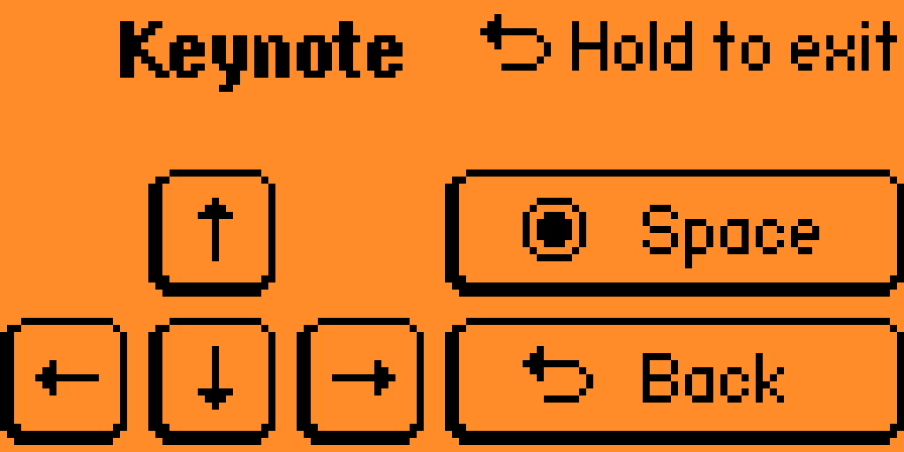

Keynote - Remote for presentations

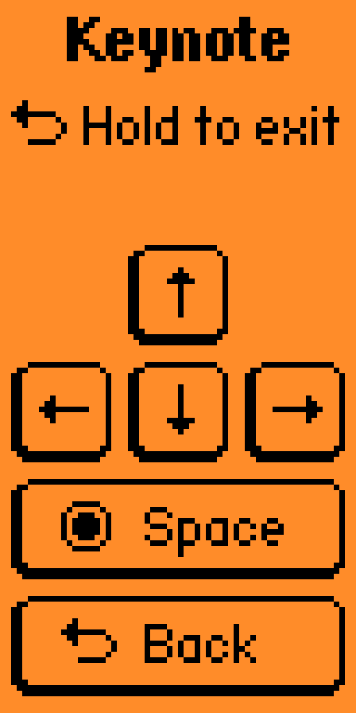

Keynote Vertical - Alternate remote for presentations

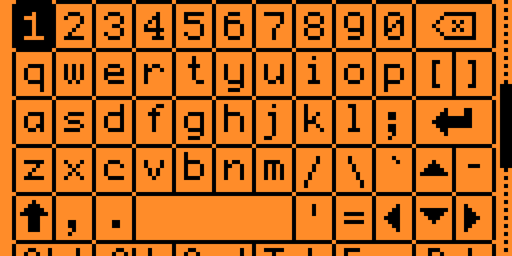

Keyboard - A functional keyboard, including modifier keys

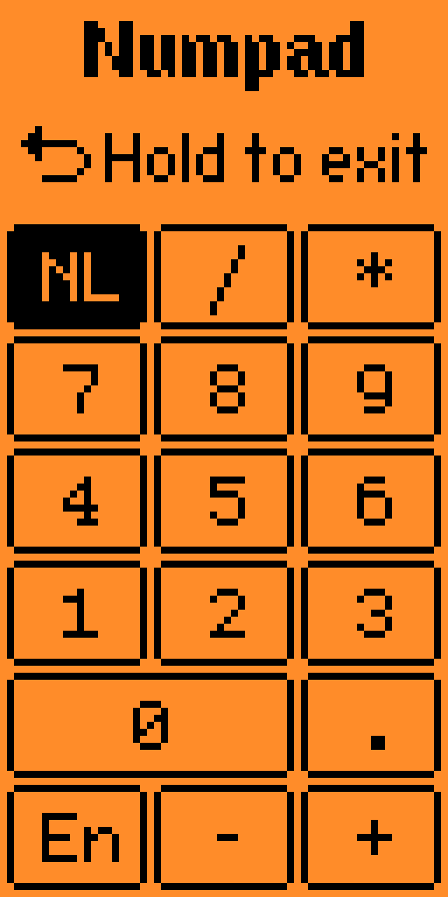

Numpad - Number pad

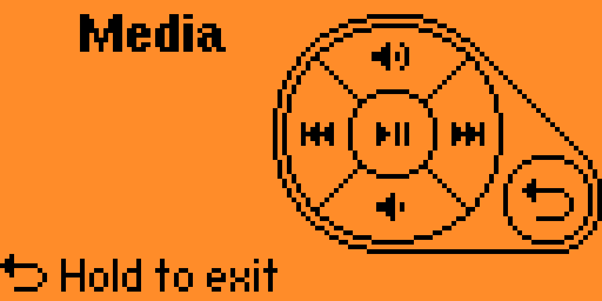

Media - Media controls

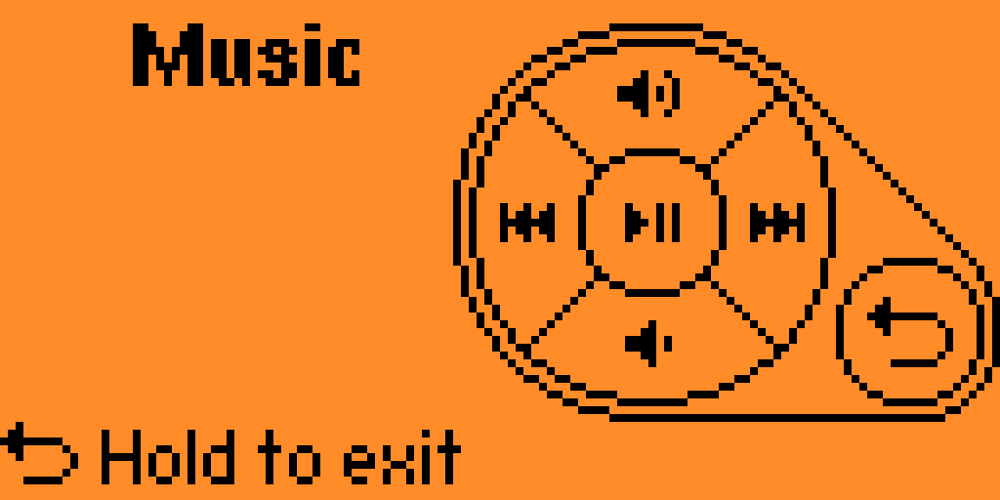

Apple Music macOS - Alternate music controls

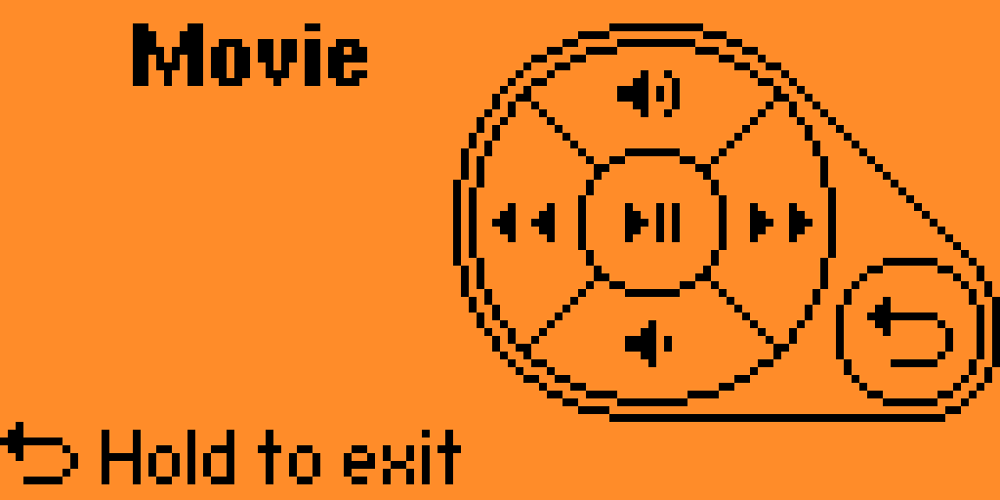

Movie - Media controls for watching a movie

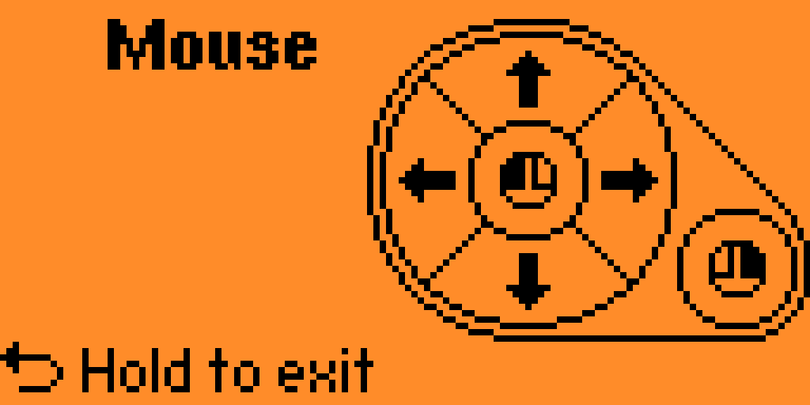

Mouse - Move the cursor and send clicks

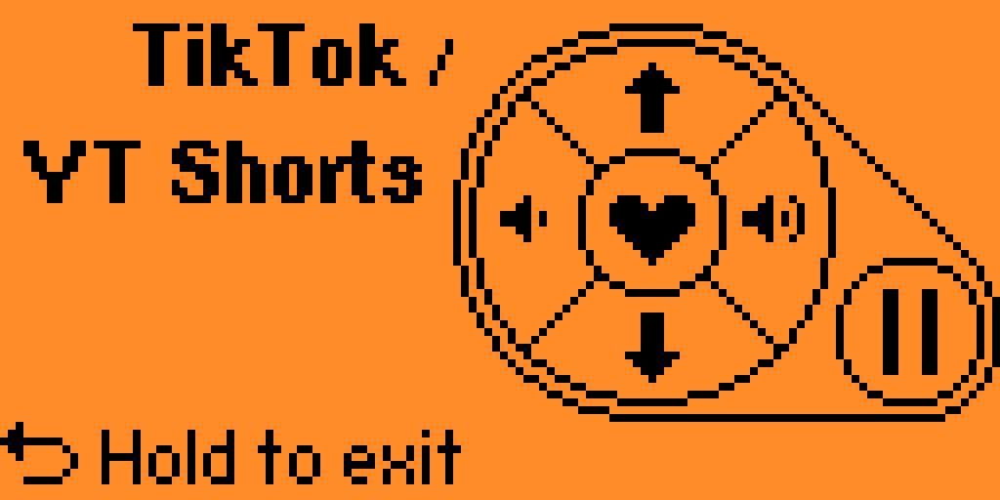

TikToc / YT Shorts - Specialized controls for short-form videos

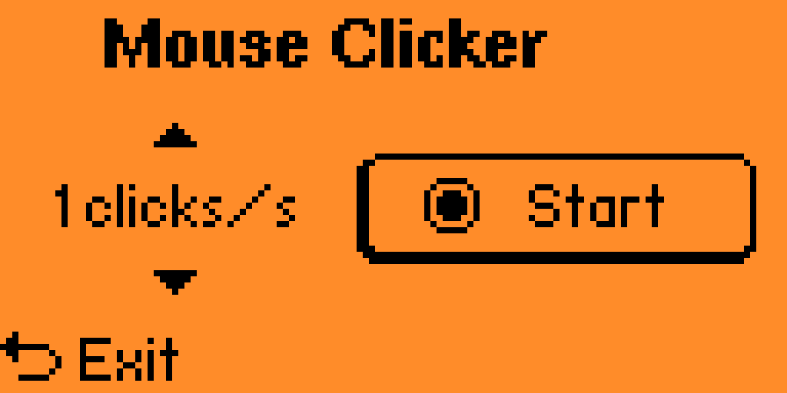

Mouse Clicker - Repeatedly click the mouse after a delay

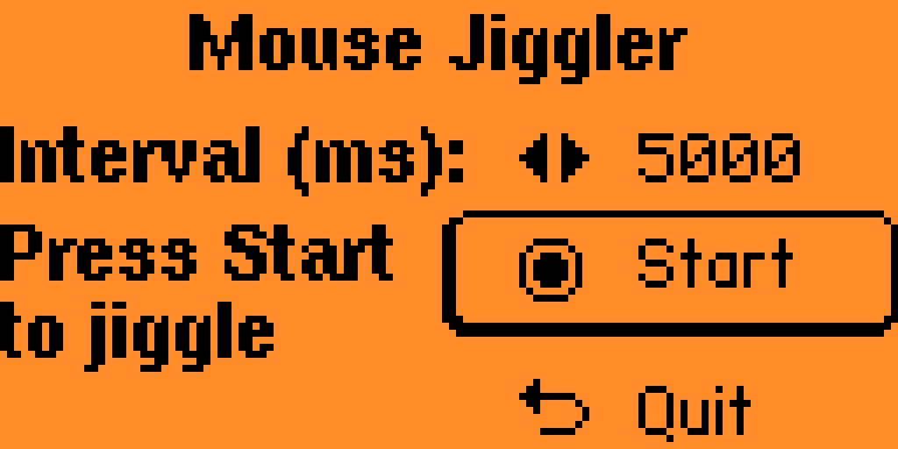

Mouse Jiggler - Moves the mouse every few seconds

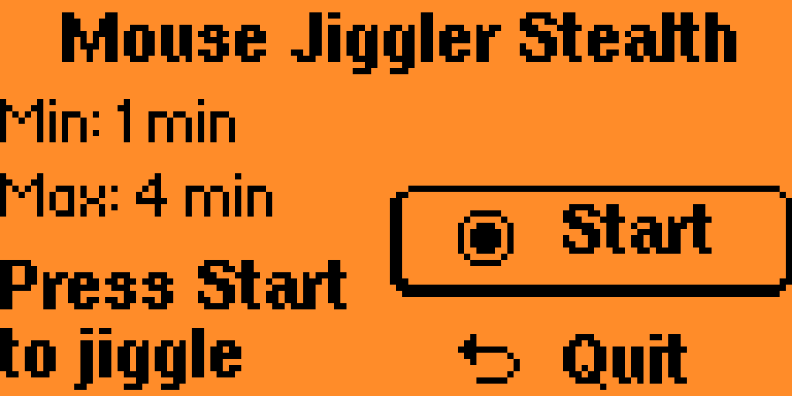

Mouse Jiggler Stealth - Moves the mouse a random direction and distance after a random time period

PushToTalk - Controls to unmute your microphone with various services
